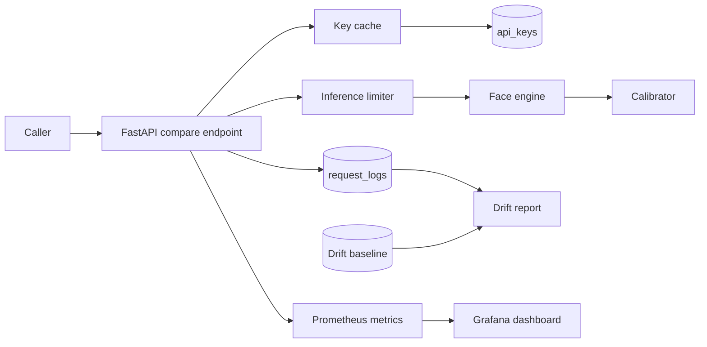

# Face Compare Drift Watch

Self-hosted face compare API that watches its own confidence drift and flags it.



## Why

A self-hosted face compare service can keep answering requests while its confidence scores quietly slide after a model or detector change. People who used to pass start failing, and nobody notices for days because latency and error dashboards stay flat. This project keeps the compare API small and stateless, then adds a drift check that compares recent scores against a frozen baseline and says in plain terms whether the service still behaves like the one that was calibrated. It is for anyone running a face compare endpoint on their own hardware.

## How it works

A caller posts two images to the compare endpoint with an API key. The request is parsed, authenticated against the key table, and handed to the inference limiter so one worker runs one compare at a time. The face engine detects the most prominent face in each image, embeds it, and maps cosine similarity to a 0 to 100 confidence through the configured calibrator. Every attempt is written to the request log with its status, latency and confidence. The drift report reads the most recent successful scores, buckets them into ten fixed bins, and compares that distribution with the frozen baseline stored in SQLite.

The drift feature sits beside the compare path, not inside it. `app/drift.py` reads the same request log the API writes, through `db.recent_success_scores`, so a detector or model swap shows up as a shift in the score distribution before callers start complaining. `bin_index` and `histogram` place each score in one of ten fixed bins over the 0 to 100 range, and `population_stability_index` sums the per-bin difference weighted by the log ratio of current to baseline share. `per_bin_shift` returns the baseline share, the current share and the delta for each bin, and `verdict` turns the index into stable, drift or large shift against the configured threshold. The baseline lives in its own `drift_baseline` table, created at startup by `init_baseline_table` next to `db.init_db`. On the first call with no baseline, `build_report` freezes the current window with `freeze_baseline` and answers `baseline_created` instead of raising a false alarm; after that, `GET /drift/report` compares the last `DRIFT_WINDOW` scores against it and reports the index, the verdict and the per-bin table.

## Key decisions

- The compare service stays stateless with no identity concept and no image persistence by default, so a leaked database holds keys and scores rather than faces. The cost is that per-person history has to live in the calling system.
- Inference is serialized per worker with a capacity limiter of one, because the OpenCV detector is not thread safe and crashes under concurrent use. Parallelism comes from the worker count, which costs memory since each worker holds its own model.
- The drift baseline is a frozen table in SQLite rather than a rolling window, so a slow slide cannot hide by moving the reference with it. The cost is that the baseline has to be refreshed on purpose after an intended change.
- Diagnostic captures of below-threshold attempts are opt-in and kept as a bounded ring buffer, which makes real failures reviewable without letting the table grow.

## Tech stack

- Python 3.11, FastAPI, Gunicorn with Uvicorn workers
- DeepFace with TensorFlow CPU, OpenCV headless, NumPy
- SQLite through aiosqlite, shared by the API and the admin service
- Prometheus client, Prometheus and Grafana for metrics
- Docker and Docker Compose for the single-host deployment
- pytest for the test suite

## Quick start

Prerequisites: Docker with Compose, and Python 3.11 if you run the tests outside a container.

```bash
cp .env.example .env
docker compose up -d api
docker compose --profile demo up -d demo
docker compose up -d prometheus grafana admin
```

| Variable | What it sets | Default |
| --- | --- | --- |
| `API_CREDENTIALS` | Inline JSON array of api_key, api_secret and client label | empty |
| `MODEL_NAME` | Recognition model backend | `Facenet512` |
| `DETECTOR_BACKEND` | Face detector backend | `opencv` |
| `CALIBRATION_METHOD` | Linear or logistic confidence mapping | `linear` |
| `CONFIDENCE_SCALE` | Scale factor for the linear mapping | `100.0` |
| `CONFIDENCE_OFFSET` | Offset for the linear mapping | `0.0` |
| `LOGISTIC_MIDPOINT` | Midpoint of the logistic mapping | `0.5` |
| `LOGISTIC_STEEPNESS` | Steepness of the logistic mapping | `10.0` |
| `THRESHOLD_1E_3` | Confidence threshold at a one in a thousand false match rate | `62.327` |
| `THRESHOLD_1E_4` | Confidence threshold at a one in ten thousand false match rate | `69.101` |
| `THRESHOLD_1E_5` | Confidence threshold at a one in a hundred thousand false match rate | `73.975` |
| `IMAGE_DOWNLOAD_TIMEOUT_S` | Timeout for fetching an image by URL | `5.0` |
| `MAX_IMAGE_BYTES` | Largest accepted image | `10485760` |
| `MAX_IMAGE_DIM` | Longest side before downscaling, zero disables | `1024` |
| `INFERENCE_CONCURRENCY` | Compares run at once per worker | `1` |
| `MAX_CONCURRENT_REQUESTS` | Compares a worker holds before shedding load, zero disables | `0` |
| `LOG_LEVEL` | Logging level | `INFO` |
| `DB_PATH` | SQLite file shared by the API and admin service | `/data/facecomparedrift.db` |
| `ADMIN_USER` | Admin panel user | `admin` |
| `ADMIN_PASSWORD` | Admin panel password | empty |
| `GRAFANA_ADMIN_USER` | Grafana admin user | `admin` |
| `GRAFANA_ADMIN_PASSWORD` | Grafana admin password | empty |
| `DEMO_API_KEY` | Key the demo UI pre-fills | empty |
| `DEMO_API_SECRET` | Secret the demo UI pre-fills | empty |

## Usage

```bash
curl -s -X POST "http://localhost:8000/facepp/v3/compare?api_key=CHANGE_ME_KEY&api_secret=CHANGE_ME_SECRET" \
  -F "image_file1=@testdata/face1.jpg" \
  -F "image_file2=@testdata/face2.jpg"
```

```json
{
  "confidence": 78.42,
  "thresholds": {"1e-3": 62.327, "1e-4": 69.101, "1e-5": 73.975},
  "request_id": "6f1c2a4e-8b0d-4f3a-9c55-2d7e1a9b4c10",
  "time_used": 412
}
```

## Project structure

```text
app/            compare API, face engine, calibration, drift report, tests
admin/          key management and usage records
grafana/        provisioned dashboard and datasource
prometheus/     scrape configuration
scripts/        load test, failed-capture export, reference audit
docker-compose.yml
```

## Limitations

- The drift report covers confidence scores only, not per-caller or per-detector breakdowns.
- The baseline is refreshed by hand, so an intended model change needs a deliberate recalibration step.
- The service compares image pairs and keeps no identity records, so it cannot answer who a face belongs to.
- The default calibration parameters are placeholders until a reference set is measured.

## License

MIT. This project builds on [WiseFace](https://github.com/rezahsaputra/WiseFace), which is MIT licensed.
